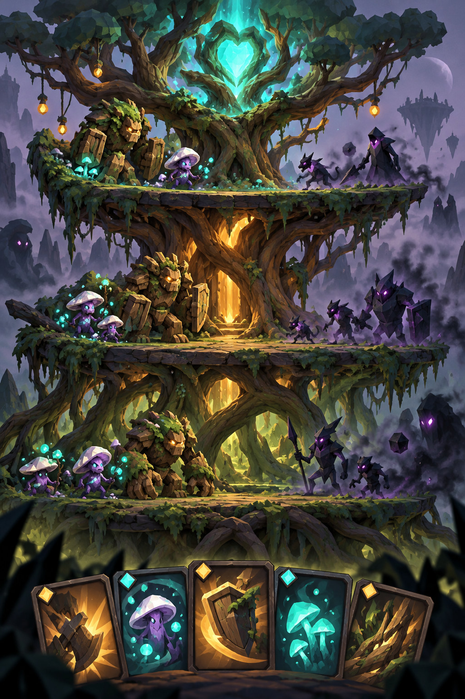
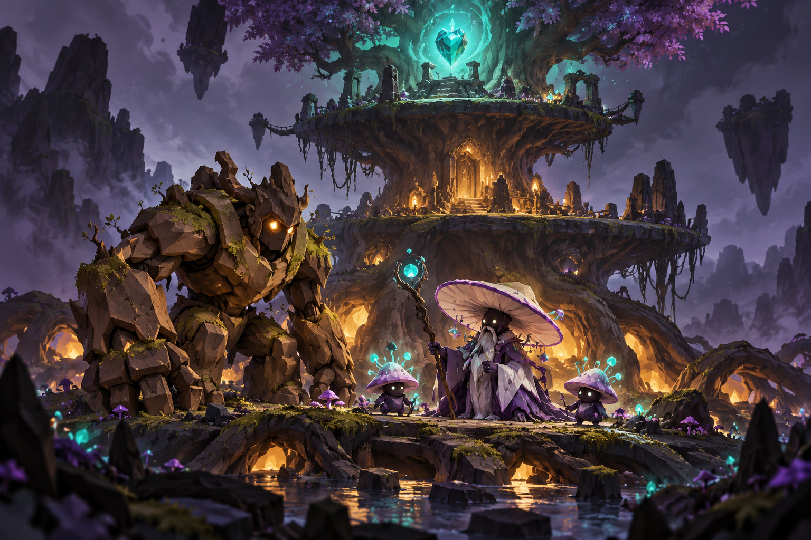
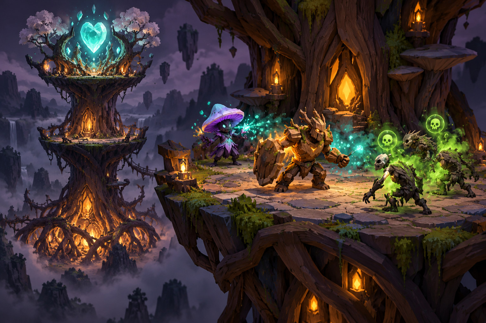
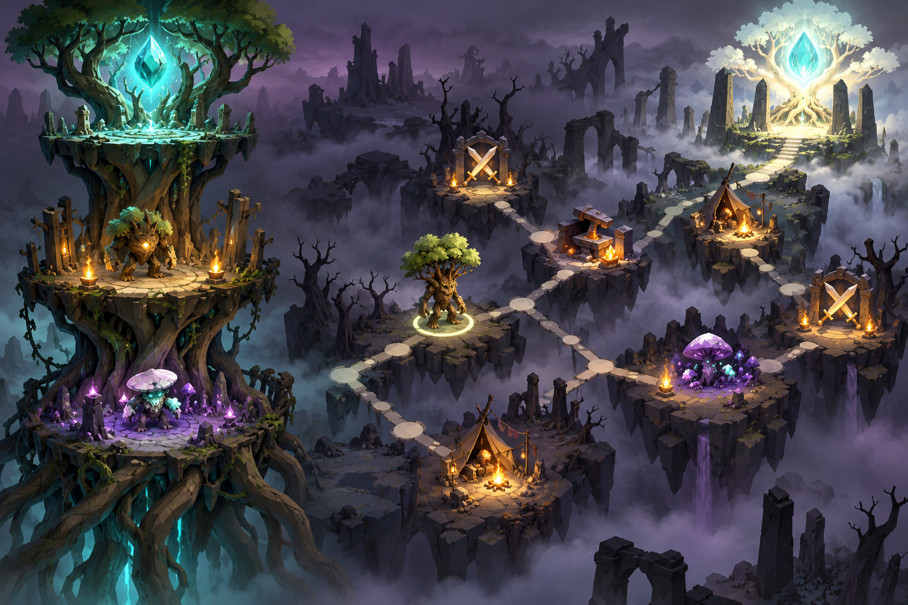
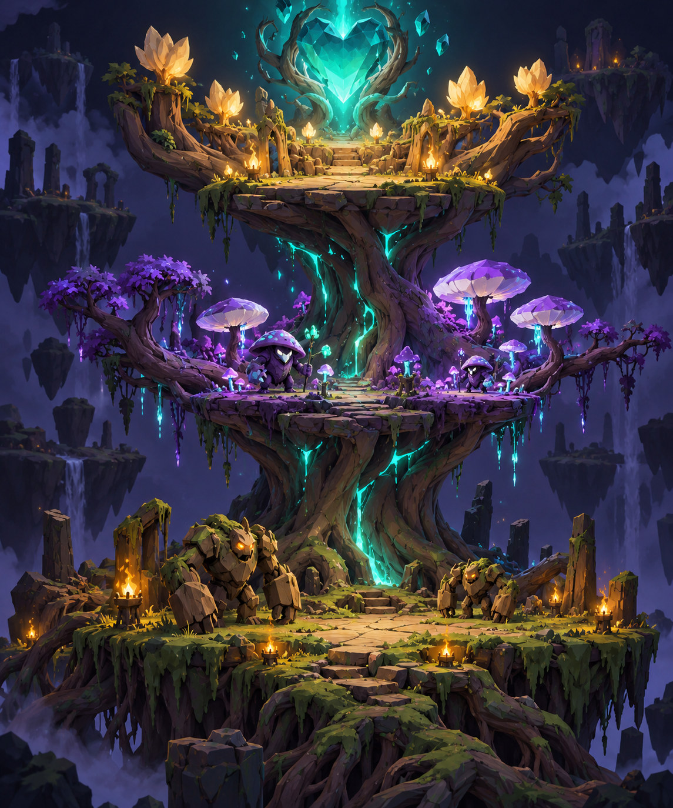

# LASTROOT

Forsvar det sidste verdenstræ. Byg et deck, der kan slå rødder.

Version 2.0 | 2026-10-19 | SPEC_READY

## Mandat til den ansvarlige kodeagent

Læs denne side først, hvis du får biblen uden resten af samtalen. Den er en arbejdsordre til dette ene spil.

### Opgaven

Byg LASTROOT fra et nyt, selvstændigt Godot-repository til en verificeret udgivelseskandidat. Brug produktkravene og opgavekortene i denne bibel som autoritativ baseline. START_HERE.md og plan/tasks.json i startpakken er praktiske kopier; PDF’en indeholder selv de nødvendige beslutninger. Status ved overdragelse er SPEC_READY: dokumenterne er færdige, spillet er ikke implementeret eller testet endnu.

### Arbejd selvstændigt

Vælg den første READY-opgave med opfyldte afhængigheder. Gennemfør en lille, sammenhængende ændring, verificér dens acceptkrav, gem beviser og commit. Fortsæt straks til næste opgave. Brug egne beslutninger til reversible detaljer, navngivning, layout og fejlrettelser. Vent ikke på feedback efter hvert skridt. Hold dig til ét aktivt integrationsspor.

### Ferie og hjemkomst

Før hjemkomst: én kodeagent arbejder alene på LASTROOT. Dag 1-7 er en relativ plan, ikke krav om at udskyde hjemkomstskift. Ved hjemkomst: aktivér faktisk tilgængelige værktøjer, bevar samme repository og fordel afgrænsede opgaver efter samarbejdskontrakten. Tidligere faseporte skal stadig være bestået.

> Langvarig autonomi kræver en aktiv agentkørsel og tilgængelig maskine. En PDF holder ikke en chatsession kørende. Checkpoints gør arbejdet sikkert at fortsætte efter pauser, kontekstskift og genstart. Ingen garanti om uafbrudt kørsel eller indtjening.

## Fra ferie-webbibel til Godot-projekt

Version 2 viderefører spillets identitet og katalog fra den vedhæftede version 1.1. Den erstatter den gamle tekniske produktionsplan.

### Bevares

Turbaseret roguelike-deckbuilder. Barkvogterne og Sporefolket, én champion hver, tre etager, 24 korttyper inklusive champions, otte relikvier, fire mutationer, fem normale kampe og Askekronen. Starttal, startdeck og bølger videreføres. Et fuldt gennemløb sigter mod 20-30 minutter efter onboarding; det skal måles, ikke antages.

### Ændres bevidst

TypeScript/Vite/Three.js erstattes af Godot 4.x og GDScript. 3D-træ, figurer og animationer bygges med verificerede Synty- og PolyPerfect-filer. UI er rigtige Godot Control-nodes. Regelsystemet er fortsat uafhængigt af rendering. Et levende 3D-diorama erstatter ikke præcis turinformation.

### Platforme

Desktop er første obligatoriske spilbare leverance, som i de tre nye bibler. Touch og et portrætlayout bevares fra LASTROOT-grundlaget. En Godot-webeksport til telefon/iPad er et særskilt kompatibilitetsspor, der afprøves tidligt og kun kaldes understøttet efter fysisk test. Der loves ikke automatisk mobilparitet med den tidligere lette webapp.

### Feriens kalender

Dag 1-7 er en relativ arbejdsplan fra projektets faktiske start. Du er allerede på ferie; planen må ikke forsinke hjemkomstskiftet for at fuldføre en kunstig kalenderuge. Ved tidligere hjemkomst aktiveres FULL-profilen, mens de samme opgaver fortsætter. Åbne faseporte består stadig.

## Spilløftet og den første beslutning

Et træ i mørket. Et bankende turkis hjerte. Fjender på vej op. Din nederste etage kan ikke redde alle alene.

### Oplevelse

Spilleren vælger et forsvar, som vokser gennem et kort gennemløb. Bark holder linjen med panser og torne; Spore opbygger gift og heling. En stærk nederste etage kan være effektiv nu, men en svag krone kan koste hjertet senere. Prognosen viser udfaldet, så tilfredsstillelsen kommer af at forbedre planen.

### De tre søjler

Rumlig deckbuilding: placering og etage betyder noget. Troværdig information: prognosen er samme simulation som virkelig kamp. Levende identitet: træets mutationer, champions og kortvalg ses i dioramaet. Hver feature skal støtte mindst én af disse søjler.

### Første ti minutter

Vælg champion; få champion plus fem normale kort og tre saftkraft. Placér en frontfigur, læg en besværgelse og læs prognosen. Afslut turen og se fjenden klatre præcis én etage. Overlev tre bølger, vælg ét nyt kort og en mutation, og se træet forandre sig. Spillet lærer én beslutning ad gangen.

> LASTROOT skal være strategisk læsbart og atmosfærisk. Ingen realtidsstyring, fri navigation, basebygning eller ny stor kampagne oven på det eksisterende deckbuilderspil.

## Run, deck og etager: autoritative grundregler

Korttype, kortinstans og kampenhed er forskellige objekter. Det er afgørende for opgraderinger, dødsfald og gemning.

| Område | Regel |
| --- | --- |
| Verdenshjerte | 60/60 liv. Ved 0 liv tabes runnet. Rødderne=0, Stammen=1, Kronen=2. Hver etage har 5 pladspoint før mutation. |
| Saftkraft | Sættes til 3 ved turstart; ubrugt kraft bortfalder. R04 tilføjer 1 på første tur. Der er ingen ophobning fra forrige tur. |
| Startdeck | Valgt B01 eller S01 + 3×B02 + 2×B07 + 2×B08 + 2×S02 + 2×S07. 12 fysiske kort, heraf 11 normale. |
| Træk | Tur 1: champion separat + 5 normale kort. Senere: 5 normale. Hvis draw er tom, bland discard med runnets gemte battle-RNG. |
| Kortzoner | Draw, hand, discard, deployed og consumed. Spillede væsner bliver ude af decket resten af kampen, også efter død. Næste kamp gendannes run-decket. |
| Flytning | Én almindelig flytning pr. enhed pr. tur for 1 kraft: naboetage eller ændret position på egen etage. Destination skal have plads; R08 kan gøre første flyt gratis. |

### Rækkefølge på etagen

Position 0 er front på hver side. Spilleren vælger lovlig indsættelsesposition med ghostpreview. En flytning committes samlet: plads, energi, position og moved_this_turn. Grenløft er separat og bruger ikke den almindelige flytning. Ingen fri bytteoperation med to fulde etager.

### Champion og reset

Champion starter i hånd hver kamp, koster 0 og optager 2 plads. Hvis den ikke spilles på tur 1, forbliver den i hånden som en eksplicit sikkerhedsregel i v2; den optager ikke et normalt træk. Ved kampstart nulstilles kampstatus og liv til opgraderede kampstartværdier.

## Turmotoren: én rækkefølge, ét resultat

Input lukkes under afvikling. Alle resultater kan beregnes uden en scene, en animation eller en fysikmotor.

### Den fastlagte sekvens

- 1. BEGIN_TURN: øg turn_number; reset flytte-/relikvieflag; sæt kraft til 3 plus relevant bonus. Anvend turstartsheling i stabil enheds-ID-rækkefølge.
- 2. DRAW_AND_WAVE: træk hånd og indsæt annonceret bølge på Rødderne. Bølger følger katalogrækkefølgen; ingen skjult rækkefølgeshuffle.
- 3. PLAYER_ACTIONS: valider kort eller flytning; afregn én transaktion; opdatér prognose. Ugyldigt mål bruger intet.
- 4. END_TURN: lås snapshot og opret resolution_id. Afvikl Rødderne, Stammen, Kronen i denne rækkefølge.
- 5. På hver etage: tick eksisterende Gift, ryd døde/events; allierede angriber front-til-bag, derefter levende fjender front-til-bag. Ryd døde efter hver handling.
- 6. Heal levende enheder med Vækst ved etagens afslutning. Nye enheder skabt under resolution venter til næste tur med at angribe.
- 7. Når alle etager er færdige: flyt normale overlevende fjender én etage op samtidig ud fra en før-flytning-liste. Ingen fjende kæmper to etager samme tur.
- 8. Fjender over Kronen skader hjertet med max(1, aktuelt angreb) og fjernes. Afregn nederlag før sejr, kassér normal hånd og gem stabil state.

### Tømning og afslutning

Døds- og reaktionsevents er FIFO med monotont event_sequence. De drænes ved de beskrevne sikre punkter, før en død enhed kan handle. Normal sejr kræver sidste planlagte bølge indsat og ingen fjender tilbage; tomt bræt efter bølge 1 afslutter ikke kampen.

> 0,5×/1×/2× og spring animation over ændrer kun præsentation. De må ikke ændre RNG, skader, rækkefølge eller belønninger.

## Statusser, skade og svære grænsetilfælde

Disse afklaringer lukker implementeringshuller i v1.1. De er markerede v2-beslutninger, ikke nye ukendte grundregler.

| Status | Præcis semantik |
| --- | --- |
| Panser N | Absorberer normal skade før liv. Bruges ned til 0 og forsvinder ikke mellem ture. Gift ignorerer panser. |
| Gift N | Giver N livsskade ved etagens giftfase; reduceres med 1, minimum 0. Tildelt Gift stables. Kun Gift til stede ved giftfasens snapshot tickes i denne fase. |
| Torne N | Efter et direkte angreb gives N normal skade tilbage, også hvis panser absorberede angrebet. Den ramtes torneværdi snapshots ved træf, også ved dødeligt træf. Ingen rekursion. |
| Vækst N | Healer levende enhed N ved etagens slutning, højst max_hp. Kan ikke genoplive. Tildelinger stables. |

### Angrebstransaktion

Validér levende angriber og forreste mål. Beregn angreb plus positionsbonus. Påfør skade. Hvis målet overlever, anvend on-hit Gift fra S01/S02. Anvend snapshot-Torne som reaktion. Registrér døds-events én gang og dræn FIFO før næste angriber. Ingen overskydende skade overføres til næste mål.

### Fjernelse og dødsvirkning

B12 fjerner et normalt allieret væsen uden death-event; Sporekolos udløser derfor ikke Gift 3. En fjende eller allieret med hp<=0 fjernes fra targetlisten med det samme. En allerede planlagt death-event behandles én gang via unit_instance_id + death_event_id.

### V2-afklaringer

S11 kræver fjende med Gift>0. Formlen er max(nuværende Gift, min(12, 2×Gift)), så et mål med mere end 12 ikke mister Gift. Områdemål uden nogen gyldig modtager afvises. Et direkte angreb er enhedens angreb, ikke en skadesbesværgelse eller et tornerespons.

## Kortkatalog · Barkvogterne

De oprindelige 24 korttyper bevares. Tal er startbalance; ændringer kræver en noteret balancebeslutning.

| ID / kort | Kraft / plads | Angreb/liv og effekt |
| --- | --- | --- |
| B01 Barkvogteren | 0 / 2 | 4/20. Champion; 8 startpanser |
| B02 Rodspire | 1 / 1 | 2/5. Ingen ekstra effekt |
| B03 Barkskjold | 2 / 2 | 2/14. 6 startpanser |
| B04 Tornhjort | 2 / 2 | 5/8. Torne 2 |
| B05 Saftbærer | 1 / 1 | 1/7. Ved spil: heal et andet allieret væsen 3 |
| B06 Gammel Eg | 3 / 3 | 8/22. Ingen ekstra effekt |
| B07 Rodslag | 1 / - | 5 normal skade til én fjende |
| B08 Barkhud | 1 / - | 6 panser til ét allieret væsen |
| B09 Rodnet | 1 / - | 3 normal skade til alle fjender på én etage |
| B10 Grenløft | 1 / - | Flyt allieret én etage op, hvis plads; separat flytning |
| B11 Saftflod | 2 / - | Heal alle allierede på én etage 5 |
| B12 Sidste Kvist | 0 / - | Fjern normalt eget væsen; træk 2; Forbrug; ikke død |

### Validering

CardDef er uforanderlig. Opgraderinger gemmes på CardInstance, ikke i den delte type. To kopier af samme kort må have forskellige opgraderinger. Mål valideres igen ved bekræftelse; en preview bruger ingen kraft og udløser ingen relikvieeffekt.

## Kortkatalog · Sporefolket

De oprindelige 24 korttyper bevares. Tal er startbalance; ændringer kræver en noteret balancebeslutning.

| ID / kort | Kraft / plads | Angreb/liv og effekt |
| --- | --- | --- |
| S01 Sporevismanden | 0 / 2 | 2/16. Champion; Gift 2 til overlevende angrebsmål |
| S02 Sporeunge | 1 / 1 | 1/6. Gift 1 til overlevende angrebsmål |
| S03 Svampevæg | 2 / 2 | 1/16. Vækst 2 |
| S04 Nattehætte | 2 / 1 | 5/5. +3 normal angrebsskade mod forgiftet mål |
| S05 Mycelievogter | 2 / 2 | 3/11. Ved spil: andre allierede på etagen får Vækst 1 |
| S06 Sporekolos | 3 / 3 | 6/20. Ved død: Gift 3 til alle fjender på etagen |
| S07 Giftpust | 1 / - | Gift 3 til én fjende |
| S08 Sporetåge | 2 / - | Gift 2 til alle fjender på én etage |
| S09 Livstråd | 1 / - | Heal ét allieret væsen 4 og giv Vækst 1 |
| S10 Nedbrydning | 1 / - | Fjern op til 8 panser fra én fjende; derefter 3 normal skade |
| S11 Blomstring | 2 / - | Fordobl Gift mod loft 12; sænker aldrig eksisterende Gift |
| S12 Sporeregn | 1 / - | Gift 1 til alle fjender på alle etager; Forbrug |

### Validering

CardDef er uforanderlig. Opgraderinger gemmes på CardInstance, ikke i den delte type. To kopier af samme kort må have forskellige opgraderinger. Mål valideres igen ved bekræftelse; en preview bruger ingen kraft og udløser ingen relikvieeffekt.

## Champions, lejre og opgraderinger

Byggets retning bliver tydelig gennem to championvalg og højst én opgradering på hver normal kortinstans.

| Champion | Retning A | Retning B |
| --- | --- | --- |
| Barkvogteren | Værn: +8 max_hp og +4 startpanser pr. trin. | Vrede: +3 attack og +2 max_hp pr. trin. |
| Sporevismanden | Giftmester: +1 on-hit Gift pr. trin. | Livsvæver: heal alle allierede på egen etage 1 pr. trin ved turstart. |

### Valgt efter kamp 2 og 4

Første valg låser retningen. Andet valg opgraderer samme retning til trin 2. Championforbedringer er run-data og gælder fra næste kamp. De må ikke lægges til igen ved load. Før/efter-visning bruger de beregnede endelige værdier.

### Normal opgradering

Væsner: +2 attack ELLER +5 max_hp for 25 harpiks. Hver kortinstans kan opgraderes én gang. Besværgelser: B07/B09 +3 damage; B08 +2 armor; B11 +2 healing; S07/S08/S12 +1 Gift; S09 +2 healing; S10 +3 damage. S10s panserfjernelse og S09s Vækst ændres ikke.

### Kort uden direkte primærtal

B10 og S11 får -1 kraft for 35 harpiks, minimum 0. B12 er allerede gratis og har ingen opgraderbar primæreffekt i denne version; det vises som ikke opgraderbart og tager aldrig betaling. Dette afklarer den generelle regel fra v1.1, som ellers kunne sælge en virkningsløs forbedring.

### Målvalg ved Saftbærer

Vælg først ledig plads og derefter et andet allieret væsen til heal, hvis et findes. Hvis ingen anden allieret findes, må B05 stadig indsættes; kortet advarer om, at heal-effekten går tabt. Handlingen er atomisk, så annullering ikke efterlader en gratis figur.

## Relikvier og træmutationer

Stærke små ændringer skal kunne læses både i tal og på det levende træ.

| ID / relikvie | Effekt |
| --- | --- |
| R01 Barkperlen | Egne Bark-væsner får 3 panser ved indsættelse; Barkchampion inkluderet. |
| R02 Dugdråben | Første spillede besværgelse pr. tur koster 1 mindre, minimum 0. |
| R03 Sporelyset | Første faktiske spillerforårsagede Gift-tildeling pr. tur får +1 på første mål; ved område vælges laveste instance_id. |
| R04 Solfrøet | +1 saftkraft på første tur i hver kamp. |
| R05 Hjemmeroden | Heal hjertet 4 efter vundet kamp, højst max_hp. |
| R06 Bladbogen | Træk ét ekstra normalt kort på kampens første tur. |
| R07 Ravkernen | Egne normale væsner får +3 max_hp ved indsættelse; champion undtaget. |
| R08 Vandrerringen | Første almindelige flytning pr. tur er gratis. |

### Relikvieudbud

Efter kamp 2 og 4 vises tre forskellige endnu ikke ejede relikvier; vælg ét. Udbuddet genereres og gemmes én gang. R02 bruges af første lovligt spillede spell, også hvis dens grundpris allerede er 0. R03 omfatter kort, on-hit og spillerens dødsvirkninger, men ikke gift-tick. Preview forbruger aldrig flag.

### Fire mutationer

M01 Dybe rødder: +1 plads på Rødderne. M02 Stærk stamme: +1 attack til allierede på Stammen. M03 Mild krone: heal 2 på Kronen ved turstart. M04 Stort hjerte: +15 max-/aktuelt hjerteliv én gang. Vælg én efter kamp 1 og en anden efter kamp 3.

> M02 er afledt af nuværende placering. At flytte frem og tilbage må aldrig akkumulere angreb. Mutationernes visuals ændrer ikke collision eller klikmål.

## Fjendekatalog og fem faste kampe

Alle normale kampe indsætter tre annoncerede bølger på tur 1-3. Derefter kommer ingen nye fjender.

| ID / fjende | Angreb / liv | Startpanser |
| --- | --- | --- |
| E01 Askeling | 2/5 | 0 |
| E02 Kulskjold | 3/9 | 4 |
| E03 Glødjæger | 5/7 | 0 |
| E04 Sodbærer | 2/12 | 0 |
| E05 Stenbrud | 6/16 | 6 |

| Kamp | Bølge 1 | Bølge 2 | Bølge 3 |
| --- | --- | --- | --- |
| 1 | 1 Askeling | 2 Askelinger | 1 Kulskjold |
| 2 | 1 Kulskjold | 2 Askelinger + 1 Glødjæger | 1 Sodbærer |
| 3 | 2 Kulskjolde | 2 Glødjægere | 1 Stenbrud |
| 4 | 1 Sodbærer + 2 Askelinger | 1 Kulskjold + 1 Glødjæger | 2 Stenbrud |
| 5 | 2 Sodbærere | 2 Kulskjolde + 1 Glødjæger | 1 Stenbrud + 2 Glødjægere |

### Placering og overflow

Fjender har ikke spillerens pladspointbegrænsning. Nye bølger tilføjes bag eksisterende fjender på Rødderne i katalogrækkefølge. Ved opstigning tilføjes indkommende fjender bag dem, som allerede står på destinationen. Logiske arrays er autoritative; visningen komprimerer slots uden at fjerne fjender.

### Læsbar fjendeskala

Askeling er lille og hurtig i animation, Kulskjold kompakt, Glødjæger spids og offensiv, Sodbærer rund/tung, Stenbrud bred og pansret. Forskelle er visuelle og katalogbestemte; der må ikke tilføjes nye evner fra et købt creatureasset.

## Askekronen: slutbossens fulde kontrakt

Bossen bliver, hvor modstanden står. Det skaber en anden plan end den normale opstigningsrytme.

### Varsel og ankomst

Tur 1: 2 Askelinger. Tur 2: 1 Kulskjold. Tur 3: 1 Glødjæger + 1 Sodbærer. Tur 4: 1 Stenbrud. Tur 5: Askekronen på Rødderne med 8 attack, 60 hp og 8 panser. Bossbanner og kommende bølge er synlige fra kampstart.

### Forankring og kamp

Bossen deltager i samme rækkefølge som øvrige fjender. Efter alle etagers kampfase bliver den på sin etage, hvis mindst én levende allieret står dér. Ellers rykker den én etage op ved fælles opstigning. Den må aldrig angribe igen på destinationen samme tur. Bossen kan forgiftes, men ikke flyttes/fjernes af effekter.

### Eskalation og slutstatus

Fra tur 10 inklusive får bossen permanent +2 attack ved hver turstart, mens den er i live. Når bossen forlader Kronen, tabes kampen uanset resterende hjerteliv. Sejr kræver boss og alle andre fjender døde samt hjerte>0. Ved samtidig hjerte=0 og sidste fjendes død vinder nederlagsprioriteten.

### Bossens præsentation

En forkullet krone af grene og sten, indvendig glød og et tydeligt ansigt/silhouette. Brug en eksisterende kompatibel rigbase og egne attachments, hvis passende asset findes. Introduktionen varer få sekunder og kan springes over. Bossen må ikke fylde klikflader eller skjule sit hp-/pansertal.

> Golden test: boss på Rødderne med levende forsvarer bliver stående. Samme state uden forsvarer rykker til Stammen én gang. Boss på Kronen uden forsvarer giver nederlag.

## Rutekort, økonomi og belønningsrækkefølge

Fem normale kampe plus boss er altid obligatoriske. Grenene ændrer dit build, ikke hvor mange kampe du slipper for.

### Rutekonstruktion

Kamp 1 -> belønning -> vælg én af to knuder -> kamp 2, og tilsvarende frem til kamp 5. Efter kamp 5 vælges én af to knuder før bossen. Knudetyper er lejr, kortbelønning, møde og fjernelse. De to muligheder har forskellige typer; hele ruten og belønningsudbud genereres fra navngivne RNG-strømme og gemmes.

### Økonomi

Start 30 harpiks. Normal sejr: +20 harpiks og vælg ét normalt kort blandt tre forskellige typer, eller spring over. Kortbelønningsknude giver samme kortvalg uden ekstra harpiks. Lejr: betal 25 eller 35 for én lovlig upgrade, eller spring over. Fjernelse: 15 harpiks, ét normalt kort; mindst syv normale kort skal blive. Møde: vælg 15 harpiks eller heal hjertet 8.

### Fast rewardflow

Commit kampsejr -> R05-heal -> +20 harpiks -> kortvalg -> ekstra reward efter kampnummer. Kamp 1/3: mutationvalg. Kamp 2/4: championforbedring, derefter relikvievalg. Til sidst rutegren. Bosssejr giver epilog og runresultat, ikke en meningsløs købsknude efter slutningen.

### Transaktioner

Hvert rewardslot og hver route node har et stabilt id med offered/claimed/skipped. Save gemmer det konkrete udbud før visning. Dobbeltklik, genstart eller tilbageknap kan hverken rerolle udbuddet eller afregne valuta igen. Et rewardflow med manglende indhold viser en fejl og gendannelsesmulighed; aldrig tavs gratis belønning.

## 3D-scene, kamera og brugerflade

Et orkestreret diorama med tre tydelige kamplinjer. Ingen fri bevægelse eller fysikbaseret afgørelse af kortkampen.

### Sceneopbygning

BattleScene: WorldEnvironment, TreeStage, tre FloorView-nodes med AllyAnchors/EnemyAnchors, HeartView, CameraRig og CanvasLayer/HUD. Hver UnitView læser et unit_id og en præsentationstilstand. Mesh, skeleton og particles er børn af VisualRoot. Domænet indeholder ingen NodePath eller Transform3D.

### Kamera

Låst let skråt sidekamera med ortografisk projektion som første valg. Alle tre etager og hjertet ses i normal beslutningsmode. Kort detaljezoom må aldrig skjule målvalg. Kampafvikling kan fremhæve etagen med lys/ramme og et lille kameraskift; reduced motion holder kameraet fast.

### Desktop og touch

Desktop 1920×1080: etager i midten, prognose/inspektør til højre og hånd nederst. Touchportræt 390×844: tre kompakte etager, tap-til-læs og et flytbart detaljepanel. Tap kort -> tap lovligt mål -> bekræft er standard; drag er valgfrit. Ingen regel kræver hover eller højreklik. Test også 844×390 og iPad 768×1024.

### HUD-kontrakt

Vis hjerte current/max, kraft, plads pr. etage, turn/bølge, draw/discard/deployed, enheders attack/hp/status og forventet hjerteskade. Korttekst er rigtig tekst. Farver kombineres med ikoner og tal. Hitflader har mindst 48 logiske UI-enheder ved målskala; safe areas afprøves på faktiske enheder.

## Prognosen: spillets vigtigste tillidskontrakt

Hvis prognosen er forkert, er strategien forkert. Derfor må den ikke være en separat, forenklet beregner.

### Én ren reducer

BattleReducer.apply(state, command) -> Result med next_state, events og errors. resolve_end_turn bruger samme kode i preview og faktisk afvikling. Forecast kloner state inklusive RNG og eventtællere, udfører resolve og returnerer en diff. Preview må aldrig mutere originalstate eller bruge dens RNG videre.

### Hvad vises?

Forventet hp/panser pr. enhed, dødsmarkering, fjendernes næste etage, hjerteskade og ændrede statusser. Markér særlig risiko, når boss forlader Kronen. Vis resultatet af næste turafslutning, ikke en upræcis påstand om flere fremtidige ture med ukendte kortvalg.

### Performance og invalidering

Genberegn ved en lovlig ændring eller ændret målpreview. Cache på canonical_state_hash + preview_command, ikke på billedframe. Små states kan beregnes synkront; debounce UI-preview ved behov. Hvis beregningen er forsinket, mærkes den forrige prognose som forældet og må ikke vises som aktuel.

### Bevis

Mindst 100 gemte deterministiske scenarier sammenligner canonical next_state og ordnede events mellem prognose og reel resolution. Scenarierne spænder over død, torne, gift, flytning, mutation, relikvie, boss, save/restore og tomme bunker. Ingen test er bestået ved kun at sammenligne det endelige hjertetal.

> Card View og AnimationTree er præsentation. Hverken animationalt call_method-spor, skud-/slagkontakt eller lydcallback må udløse autoritativ skade i LASTROOT.

## Synty og PolyPerfect: konkret assetplan

Bevar de vedhæftede billeders klare identitet: bark/rav, svampe/violet, turkist liv og mørke fjendesilhuetter.

| Behov | Prioriteret løsning | Godkendelseskrav |
| --- | --- | --- |
| Træ og etager | Synty natur, klipper, rødder og fantasyprops; saml en projektspecifik TreeStage. | Tre klare gulve; støttegeometri må ikke skjule figurer eller UI. |
| Barkvogter | Passende styliseret humanoidbase med bark-/stenattachments; eksisterende rig bevares. | Bred brystkasse, ravblik, tydelig front og stabilt attack/hit/death. |
| Sporevismand | Lille humanoidbase med stor svampehat, stav og sporedetaljer. | Læsbar hat og stav, greb korrekt; ingen dyr cloth-/ansigtsrig. |
| Normale væsner | Synty/PolyPerfect-figurer, hvor silhouette og adgang matcher behov. | Én samlet farve/materialestil; ikke-humanoide rigs behandles separat. |
| Tornhjort | Kun passende quadruped med godkendte clips; ellers tydeligt proxyasset indtil udfyldning. | Ingen dårlig humanoidretarget på fire ben. Visuel kvalitet ved kamera godkendes. |
| Fjender og boss | Genbrug få passende rigfamilier med egne attachments, størrelser og materialer. | Visuel variant giver ikke nye evner; tal følger EnemyDef. |

### Import og realisme

Kontrollér faktisk pakkeindhold og Godot-version. Nogle Synty-leverancer har Godotstøtte; det betyder ikke, at alle ejede pakker eller PolyPerfect-filer er færdigimporterede. Foretræk verificerede source/GLB/FBX-filer. Unity scripts, controllers og shaders bliver ikke Godot-funktioner ved kopiering.

### Style gate

Lav en line-up med begge champions, to normale væsner og to fjender under samme lys. Match størrelsessprog, materialer og bevægelsestempo. Vælg konsistens frem for at vise alle købte pakker. Bevar leverandøroriginaler og registrér hver bearbejdet variant.

## Animation: dramatisér et allerede afgjort resultat

Tilpas tidligere erfaringer om rig, sockets og timing til en turbaseret motor. Ingen combat-callback må ændre udfaldet.

### Minimumsbibliotek

Humanoider: idle, summon, attack/cast, hit, death, defend og victory. Træ: hjertepuls, hjerteskade, mutation og afslutning. Firbenede væsner: egne idle/attack/hit/death, ikke humanoidprofil. Flyt/opstigning sker mellem faste anchors; visningen tweenes, mens domænets etage allerede er korrekt.

### Rig og events

Kontrollér bone names, hierarchy, rest pose, facing, scale og våben-/stavsocket. AnimationPlayer rummer clips; AnimationTree eller en enkel eksplicit statecontroller styrer blending. Korte stationære angreb er standard. Retarget afprøves i RigLab og i den rigtige etagescene. In-place forhindrer root motion i at ændre formationen.

### Event Player

Reducer producerer immutable events med sequence, actor_id, target_id, kind, before/after og visual_hint. BattlePresenter spiller dem og opdaterer en visuel state. Ved skip sættes views direkte til den endelige state; events afregnes ikke igen. Indtastning genåbnes efter synkronisering, eller kontrolleret timeout hvis en clip mangler.

### Visuel port

Test summon->attack->hit->death, simultane dødsvirkninger, pause, 2x, skip og load. Stavens sporeglød og barkslag skal ramme det viste mål. Døde figurer forsvinder pænt uden ragdollkaos. Synlige tal følger eventets outcome. Et hængende animationssignal må aldrig låse runnet.

> Væsentlig forskel fra shooter-biblerne: LASTROOT beregner kamp først. Animationens kontaktframe synkroniserer feedback, men ejer aldrig skade, død eller kortbelønninger.

## Domænemodel, seed og saveformat

Hele runnet kan serialiseres og testes uden 3D-assets.

| Model | Minimumsfelter |
| --- | --- |
| CardDef / CardInstance | def_id, kind, cost, space, base_stats, effects / instance_id, def_id, upgrade_id. |
| UnitInstance | unit_id, card_instance_id eller enemy_def_id, side, floor, position, hp, max_hp, armor, poison, thorns, growth, moved_this_turn, spawned_resolution. |
| RunState | schema_version, content_version, run_id, main_faction, deck, champion_path/rank, relics, mutations, resin, heart, route, reward_claims, RNG-streams. |
| BattleState | battle_id, turn, phase, zones, energy, wave_index, units, relic_turn_flags, event_sequence, resolution_id og terminal_result. |
| SaveEnvelope | game_id, build_id, schema_version, checksum, timestamp, run, battle, pending_reward, presentation_checkpoint. |

### Deterministisk rækkefølge

Unit-ID er et monotont heltal inden for runnet og gemmes som next_unit_id. Så er R03s laveste ID entydigt. Sortér aldrig efter scene-tree-rækkefølge eller hashmaps. Skil RNG-strømme for shuffle, route og reward; gem både seed og generatorstate. Ingen rendering eller idlevariation bruger gameplay-RNG.

### Sikre checkpoints

Gem efter lovlig spillerhandling og efter færdig resolution som atomisk transaktion. Under animation er authoritative final_state allerede gemt med presentation_pending. Load viser direkte det færdige resultat eller genafspiller kun visuals; der trækkes ikke ny hånd. Bevar sidste gyldige backup, valider schema og tilbyd JSON-eksport/import.

## Testmatricen: konkrete forventede resultater

Ud over 100 prognosefixtures skal disse håndberegnede prøver have tydelige assertions.

| ID | Input | Forventet |
| --- | --- | --- |
| T01 | Gift 3, hp 5, panser 4. | hp 2, Gift 2, panser 4 efter giftfase. |
| T02 | Angriber 5 dmg, hp 2. Mål hp 3, panser 1, Torne 2. | Mål dør; angriber dør af snapshot-torne; præcis to døds-events. |
| T03 | En normal fjende overlever på Rødderne. | Slutter på Stammen; ingen ekstra kamp på Stammen samme tur. |
| T04 | M02 aktiv; unit grundattack 2 flyttes ud/ind. | Attack er 3 på Stammen og 2 udenfor; ingen akkumulering. |
| T05 | B12 fjerner Sporekolos. | Træk 2, ingen death-Gift; B12 consumed og unit deployed/removed resten af kampen. |
| T06 | S11 på Gift 7 / Gift 14. | 12 / 14 Gift; ingen nedjustering ved loftet. |
| T07 | R03 med S08 og to mål id 8/3. | Id 3 får Gift 3, id 8 får Gift 2; preview forbruger ikke flag. |
| T08 | Dobbelt claim af vundet kamp. | Kun +20 harpiks én gang og ét kortvalg. |
| T09 | Champion ikke spillet tur 1. | Champion bliver i hånd; næste tur trækker stadig 5 normale. |
| T10 | Gift dræber sidste fjende efter bølge 1. | Ingen tidlig sejr; senere bølger er stadig planlagt. |

### Yderligere kanter

Afvis ugyldigt mål uden kraftforbrug; 0-kost-spell bruger R02s første-spellflag; R08 bruger kun normale flyt; max_hp-upgrade gælder én gang; bossen eskalerer tur 10; heart=0 prioriteres over sejr. Test pause/skip/restore med identisk slutstate og eventliste.

## Kvalitet, performance og produktmål

Det lille spil skal være komplet og lækkert, før det bliver større.

### Budgetter

Desktopmål: 1080p/60 fps på faktisk dokumenteret feriemaskine eller separat referenceprofil. Arbejdsmål p95 frame <=16,7 ms; mobilwebmål mindst 30 fps med reduceret lys/partikler. Mål forecast latency med 100 scenarios; mål under 50 ms på referencehardware. Slå tunge skygger fra før du fjerner tal eller tydelige mål.

### Testbar scene

Alle tre etager, 15+ venlige/fjendtlige views, statuseffekter, hånd og prognose. Kort tekst skal være læselig i 720p og touchprofil. Ingen netværks-/betalt AI-afhængighed under spil. Assetdownloadbudget fastsættes efter måling af Godot-eksporten; det gamle 10 MB-webmål videreføres ikke som uprøvet løfte.

### Spiltest og balance

Begge champions skal kunne vinde på mindst én normal lovlig rute uden debugkort. Kør faste seedserier og rapportér antal forsøg, winrate, tabt hjerteliv, turncount og kortvalg. En bot er regressionstest, ikke bevis for sjov. Fem eksterne testere er mål; mindst fire skal forstå forecast og målvalg uden hjælp efter onboarding.

### Udgivelse og fravalg

Premium singleplayer med gratis demo er en kommerciel hypotese. Test betalingsvilje ud fra en rigtig demo; ingen indtjeningsgaranti. Glødsværmen, Måneflokken, multiplayer, onlineleaderboards og omfattende meta-progression er senere scope. Første udgivelse leverer den beskrevne sekskampskerne med genspil gennem deck, route, mutation og championvalg.

## Fire faser og bindende leveranceporte

Tidsangivelser efter ferien er planlægningsintervaller, ikke løfter. Portene afgør, hvornår næste fase begynder.

| Fase | Leverance og port | Plan |
| --- | --- | --- |
| 1 · Fundament | Spilbar første kamp i Godot: tre etager, startdeck og to champions, alle fire statusser, sand prognose, save/load og native eksport. Fuld sekskampstur er strækmål. | Dag 1-7. 12 opgaver. |
| 2 · Kvalitetsudsnit | Komplet gennemløb med 24 kort, 8 relikvier, 4 mutationer og Askekronen. Godkendt Synty/PolyPerfect-udsnit og animationer. 100 prognosescenarier matcher. | Efter hjemkomst; ca. 1-2 arbejdsuger. 8 opgaver. |
| 3 · Komplet spil | Alle seks kampe, rutegrene, championretninger, relevante opgraderinger og brugerflows er polerede. Begge champions kan vinde via dokumenteret lovlig rute. | Ca. 2-4 arbejdsuger efter fase 2. 10 opgaver. |
| 4 · Udgivelse | Ren desktopreleasekandidat med savekompatibilitet, tilgængelighed, verificeret referencehardware, ærlig demo og fuld agentoverdragelse. | Ca. 1-2 arbejdsuger efter fase 3. 6 opgaver. |

### Portregel

En port består kun, når alle obligatoriske opgaver i fasen er DONE med faktiske beviser. BLOCKED_ENVIRONMENT er ikke godkendt. Et midlertidigt proxyasset er tilladt i fase 1, hvis det er registreret; det tæller ikke som godkendt animation, Synty-integration eller udgivelsesgrafik.

### Opgavernes rækkefølge

Opgavekortene har entydige ID’er, afhængigheder, ændringsområde, trin og accepttest. Der er 36 kort. En senere fase må undersøges uden at åbne store implementeringsspor. Hver ny feature skal fjerne et kendt problem eller opfylde et konkret krav. Udvid ikke scope, fordi agenten har ledig kontekst.

> Hvis kerneoplevelsen ikke fungerer i gråblokke, forbedres den før flere baner, flere systemer og dyrere grafik. En poleret forkert kerne tæller ikke som fremskridt.

## Syv feriedage: leverancer dag for dag

Dag 1 betyder den faktiske startdag. Planen dækker syv hele dage, også når de krydser en kalenderuge.

| Dag | Arbejde | Bevis ved dagens slutning |
| --- | --- | --- |
| 1 | LR-01/02: miljøaudit, Godot-boot og valideret datamodel. | Tre tydelige etager og struktureret state; ingen assetblokering. |
| 2 | LR-03/04: turmotor, FIFO-events, død og statusser. | Reproducerbare forventede resultater uden rendering. |
| 3 | LR-05/06: startdeck, kortmål og sand prognose. | Begge champions samt startkort kan spilles; forecast matcher. |
| 4 | LR-07/08: touch/mus-UI, 3D-træ og præsentationsadapter. | Kort -> gyldigt mål -> bekræft -> synlig konsekvens. |
| 5 | LR-09/10: første tre bølger, save/load og genoptagelse. | Første kamp har sejr/nederlag; load reroller aldrig hånden. |
| 6 | LR-11: reel importprøve og sammenhængende spiltest. | Synty/PolyPerfect-prøve hvis assets findes; ellers registrerede proxies. |
| 7 | LR-12: port, eksport og hjemkomstcheckpoint. | Kørbar kampdemo med beviser; videre til næste READY-opgave ved overskud. |

### Prioritet ved lavere kapacitet

Beskyt kontrol, kamera, kernesløjfe, save/load og en start-til-slut-demo. Skær ekstra indhold og visuel pynt først. Skriv præcist hvad der er udskudt og hvorfor. De syv dage er en fokuseret produktionsperiode; arbejdsdagens længde afhænger af maskinen, agentens kørsel og fejl, der faktisk findes.

### Hvis der er tid til overs

Tag næste READY-opgave efter fase 1-porten. Udfør én kvalitetsforbedring ad gangen: styring, animation, lyd, læsbarhed, ydeevne. Undgå at starte et andet spil. En optaget gameplaysekvens med god rytme er mere værd end ti ufærdige systemer.

## Ferieprofil og overgang til fuld værktøjskæde

Det samme repository, de samme data og de samme spilregler bruges før og efter hjemkomsten.

### Første miljøaudit

Registrér operativsystem, Godot-binær og version, renderer, GPU, skærm, Git, diskplads, eksportskabeloner og hvilke Synty-, PolyPerfect- og animationsfiler der faktisk er tilgængelige. Søg i brugerens oplyste projekt- og assetmapper; opfind ikke gamle stier. Læs eksisterende AGENTS.md og tag et sikkert baseline-commit før ændringer. Hvis et LASTROOT-repository allerede findes, bevar det og lav en migrationsbranch; start ikke et konkurrerende projekt, før eksisterende arbejde er auditeret.

### Fungerende ferieprofil

Kør Godot 4.x med GDScript, lokale data og desktop-export. Hvis kun headless Godot er tilgængelig, skriv domænetests, scenesmoke og validerede data, men markér visuel kontrol som afventende. Mangler Godot helt, opbyg data, repository, specifikationer og importinventory; forsøg en tilladt lokal installation. Kald ikke dette et spilbart build.

### Manglende assets

Brug primitive figurer og egne simple farvematerialer med samme størrelse, collision og sceneinterface som det kommende Synty-asset. Skift senere VisualRig eller miljøprefab uden at ændre simulation. Mangler en animation, dokumentér clipbehovet og brug en tydeligt registreret proxy; hent ikke tilfældige nye pakker som skjult afhængighed.

### Hjemkomstkontrol

Kør den seneste build på den fulde maskine, importér de rigtige assets gennem en karantænemappe, genkør save/load og gameplaytesten, og opdatér capability-matrix. Ret miljøforskelle i små commits. Ingen opgradering af engine midt i en port uden en konkret grund, rollback og regressionskørsel.

## Agentstyring, genoptagelse og delegation

Få afsluttede, dokumenterede leverancer frem for mange samtidige halvfærdige ændringer.

### Tilstandsmaskine for opgaver

TODO -> READY -> IN_PROGRESS -> VERIFYING -> DONE. READY kræver alle depends_on i DONE. Fejl giver REWORK; manglende reel adgang giver BLOCKED_ENVIRONMENT. DROPPED kræver en dokumenteret scopebeslutning og en ændret port. Hver opgave har acceptance, owner, branch, last_commit, evidence og næste handling.

### Checkpoint efter hver opgave

Skriv STATUS.md med sidste beståede port, aktiv opgave, SHA, udførte tests, kendte problemer og næste tre READY-opgaver. Opdatér DECISIONS.md ved arkitekturvalg og RISKS.md ved konkrete blokeringer. Gem en lille test-save og et reproduktionsseed. Commit kun projektfiler; ikke credentials, buildcache eller hele rå assetbiblioteker.

### Efter hjemkomst: koordinator + højst to specialister

Koordinatoren ejer main, scope, kontrakter og integration. En specialist kan eje miljø/animation i en worktree, en anden tests/indhold i en anden. Opgaven gives med ID, mål, tilladte mapper, inputversion, acceptkrav og afleveringsformat. Ingen to agenter skriver i samme scene eller datafil. Specialistens commit integreres først efter kontrakt- og gameplaykontrol.

### Når noget stopper

Prøv højst tre forskellige, dokumenterede løsningshypoteser på samme fejl. Gem logs, lav den mindste reproduktion, og tag en anden READY-opgave hvis der er en. Efter genstart læses mandat, STATUS, DECISIONS og tasks.json før kode ændres. Afsluttede opgaver genåbnes kun ved konkret regression.

> Eksterne køb, offentlige udgivelser og beskeder til andre følger brugerens faktiske mandat. Gør bygge- og udgivelsespakken færdig, før en eventuel manglende tilladelse bliver det sidste stop.

## Repository og tekniske ejerskaber

Et enkelt Godot-projekt med små domænemoduler. Ingen webbackend, multiplayer eller fælles tre-spils-platform i version 1.

| Sti | Ansvar |
| --- | --- |
| project.godot / scenes/ | Entry scene, flow, aktører, UI, baner og testgallerier. |
| scripts/domain/ | Regler og serialiserbar tilstand. Ingen afhængighed af visuelle nodes. |
| scripts/runtime/ | Input, faste enhedsanchors og præsentationsadaptere; ingen fysikbaseret kampafgørelse. |
| data/definitions/ | Validerede Resource-definitioner med stabile ID’er. Balance ligger her. |
| assets/source_inventory/ | Metadata og checksums; kildemateriale bevares uændret uden for arbejdsfiler. |
| assets/imported/ + art/prefabs/ | Udvalgte imports og egne wrapper-scenes; ingen vendor-controller som runtime. |
| tests/ + fixtures/ | Domænetests, scenetests, save-fixtures og faste seeds. |
| docs/ + evidence/ | Bibel, beslutninger, status, opgavebeviser, profileringsresultater. |
| tools/ + builds/ | Validering/eksport; builds er genererede og holdes ude af normal kildehistorik. |

### Få globale services

AppFlow håndterer scener, SaveService håndterer filer, AudioService lydgrupper og SettingsService indstillinger. GameSession ejer det aktive domæne. Brug eksplicitte referencer og typede signals; ikke en global eventbus, som skjuler alle afhængigheder. UI sender kommandoer; det ændrer ikke tilstand direkte. BattleReducer ejer udfaldet og Presenter viser events.

### Versioner og navne

Vælg en stabil Godot 4.x, som kan køre på feriemaskinen, og lås nøjagtigt nummer i VERSION_MATRIX.md. GDScript med typer, snake_case filer, PascalCase klasse-navne. Brug composition frem for dybe arvetræer. Afhængigheder indføres kun ved dokumenteret gevinst og licens-/versionsnotat.

## Kommandoer, beviser og releaseprocedure

Kommandoerne er en startkontrakt. Agenten opretter de nævnte testfiler; de findes ikke allerede i en leveret spilimplementation.

### Minimumskommandoer [R5]

- godot --version  |  godot --help
- godot --headless --path . --import
- godot --headless --path . --script res://tests/run_tests.gd
- godot --headless --path . --script res://tests/scene_smoke.gd
- godot --path .  (spilbar og visuel kontrol)
- godot --headless --path . --export-release "Windows Desktop" builds/windows/game.exe

### Portabilitet

Brug den reelle binærsti eller et dokumenteret GODOT_BIN. Eksportpreset skal oprettes, templates matche engine, og outputmappen eksistere. På andet ferie-OS bygges også en lokal native eksport. --check-only kontrollerer et angivet script og beviser ikke hele projektet. Ukendte flags kan ignoreres; kontrollér derfor output og exitkode.

### Bevisformat

evidence/<task-id>/result.json indeholder commit, engine_version, command, exit_code, expected, observed, timestamp, fixture og status. Tilføj relevant log og screenshot/video, ikke følsomme stier eller tokens. Et screenshot uden build-ID kan ikke alene bevise en regression. Markér eksplicit NOT_RUN, PASS eller FAIL; opfind aldrig kørsel.

### Udgivelseskandidat

Byg fra et rent checkout, kør savecompatibility og en fuld kampagne, kontrollér credits/licenser, audioindstillinger, controller hvis understøttet og første opstart uden editor. Lav checksum og versionsnoter. Pak kun nødvendige runtimefiler. Behold forrige kandidat og dokumentér rollback. Offentlig storeupload er en særskilt handling efter et verificeret releasebundle.

## Værktøjskæde efter hjemkomst

Værktøjer vælges til afgrænsede resultater. Spillets kerne fungerer uden cloudtjenester under afvikling.

| Rolle | Brug og afleveringskrav |
| --- | --- |
| Codex / Claude Code | Én er koordinator. Arkitektur, kode, tests, integration og release. Den anden kan efter hjemkomst løse et isoleret specialistkort. |
| Blender / scripts / MCP | Rignormalisering, sockets, eksport, simple meshrettelser. Aflever originalreference, bearbejdet fil, GLB og importtest. |
| Synty / PolyPerfect / Mixamo | Miljøer, figurer og validerede animationshuller. Ledger og gameplaykamera-review kræves. |
| Kimi / Gemini / Grok / DeepSeek | Valgfri kritik, tekst, research eller isoleret kodehjælp hvis adgang findes. Output er forslag, indtil koordinatoren har kontrolleret det. |
| ElevenLabs | Valgfri voice/SFX efter en konkret lydliste og budget. Lokale placeholderlyde holder udviklingen i gang. |
| Meshy / billedværktøjer | Kun navngivne visuelle huller eller konceptreference. Nye assets skal passe Synty-stil og godkendes i spillet. |
| HeyGen / videoværktøjer | Valgfri præsentation/storyboard; aldrig bevis for faktisk gameplay eller erstatning for gameplayoptagelse. |

### Capability-matrix

Registrér available/unavailable, auth_mode, allowed_actions, input/output og budget for hver service. Et abonnement beviser ikke API-adgang. Ingen private nøgler i kode, screenshots eller opgaveprompts. Hvis et værktøj mangler, fortsæt med en lokal løsning og notér præcis hvilket kvalitetsarbejde der udestår.

### Reviewsløjfe

Specialist får et låst input og ét resultat. Koordinator tjekker format, import, rettigheder og accepttest. Én revision skal pege på en konkret mangel; undgå endeløs generering uden målkriterium. Grafik og lyd låses i indholdsversioner, så et nyt asset ikke ændrer alle gamle missioner utilsigtet.

## Visuel produktion: de fem øvrige situationer

Kildematerialet indeholder REF_01-05. REF_06-10 nedenfor er præcise produktionsbriefs, ikke påstået færdige billeder.

| Reference | Komposition og funktion | Godkendelsesprøve |
| --- | --- | --- |
| REF_06 · Kortmål | Battlelayout med valgt B08, forstørret korttekst og lysramme om lovlige allierede; prognose før/efter ved siden af. | Kraftpris 1, panser +6 og bekræft/annuller kan forstås uden hover. |
| REF_07 · Champion | Begge retninger ved første valg; ved andet valg kun låst retning med trin 2 og tydelig før/efter. | Tal matcher den valgte champion; billede lover ikke frit skift af retning. |
| REF_08 · Lejr | Ét normalt kort valgt til upgrade, pris, harpiks og reelt resultat. Separat overlay for relikvie-/mutationvalg. | Lejr sælger ikke relikvier/mutationer. Disse tildeles efter kampnummer. |
| REF_09 · Askekronen | Boss på én etage, tydelig hp/panser, escalationvarsel og prognose for ankring/opstigning. | Alle tre etager forbliver orienterbare; bosseffekt skjuler ikke slutrisiko. |
| REF_10 · Runafslutning | Det faktiske træ med valgte mutationer, championretning, resultat og nyt run-knap. | Ingen falske rewardtal. Afslutning kan fortsættes/springes over uden at starte to runs. |

### Arbejdsgang

Byg de fem skærme funktionelt først. Optag derefter screenshots fra Godot med faste states. Hvis nye konceptbilleder ønskes, bruges briefet til billedværktøjet; de mærkes koncept og erstatter aldrig faktisk UI-/gameplaybevis. De eksisterende fem referencer bevares i pakken som udtrukne billedfiler fra PDF’en.

### Godkendelsesstatus

De vedhæftede billeder er anvendt som brugerens arbejdsreferencer. Der antages ikke særskilt godkendelse af alle detaljer, og der påstås ingen eksisterende identiske Synty-/PolyPerfect-modeller. Regeltekst og tilgængelighed har forrang for dekorative billeddetaljer.

## REF_01 · Tre etager og kort

Eksisterende konceptreference fra det vedhæftede billedhæfte. Ikke et screenshot af et implementeret spil.

### Bevar

Tre tydelige kampetager, allierede til venstre og fjender til højre. Turkist hjerte er højeste visuelle prioritet; ravlys guider øjet gennem stammen.

### Oversæt til Godot

Byg et modulært træ omkring tre faste FloorView. Hold forreste gulvkanter fri. Kortviften er kun kompositionsreference: første hånd har faktisk champion + fem normale kort, og R06 kan øge den. Spillets UI skal kunne vise hele hånden læseligt.

## REF_02 · Barkvogter og Sporevismand

Eksisterende konceptreference fra det vedhæftede billedhæfte. Ikke et screenshot af et implementeret spil.

### Bevar

Kontrasten mellem en tung bark-/stenfigur og en lille violet svampefigur er identiteten. Ravblik og turkis magi binder dem til træet.

### Oversæt til Godot

Vælg to rigfamilier med kompatible clips. Svampehat/stav og barkplader kan være egne attachments på verificerede basismodeller. Den store scene i baggrunden er ikke et krav om fri udforskning eller enorme realtime-miljøer.

## REF_03 · Kampens komposition

Eksisterende konceptreference fra det vedhæftede billedhæfte. Ikke et screenshot af et implementeret spil.

### Bevar

Bevar tydelig front, etagekant, kontrast mellem levende natur og askefjender samt en kort spore-/giftmarkering.

### Oversæt til Godot

Kampkameraet viser alle etager før beslutning. Billedets nærbillede er en valgfri kort fremhævelse under afvikling. Gift får et genkendeligt ikon/tal; røg og effekter må ikke skjule prognosen. Fjendernes design ændrer ikke deres katalogevner.

## REF_04 · Vejvalg gennem løbet

Eksisterende konceptreference fra det vedhæftede billedhæfte. Ikke et screenshot af et implementeret spil.

### Bevar

Flydende øer, varme lejrsteder og broer visualiserer et forgrenet gennemløb. Den aktuelle position skal stå tydeligt.

### Oversæt til Godot

Lav et 2D-nodekort med valgfri 3D-dioramabaggrund. Fem normale kampe og boss er obligatoriske; billedets frie stier bestemmer ikke reglerne. Kun én af to mellemknuder vælges. UI viser type, pris, reward og låst/valgt tilstand.

## REF_05 · Træets hjerte og lag

Eksisterende konceptreference fra det vedhæftede billedhæfte. Ikke et screenshot af et implementeret spil.

### Bevar

Tre adskilte terrasser, pulserende turkist hjerte, violette svampe og barkfigurer. Levende detaljer giver identitet uden fotorealisme.

### Oversæt til Godot

Brug som art-gate for TreeStage: form først, lys bagefter, små props til sidst. Placér aldrig træstamme, hat eller krystaller foran enhedstal. Mutationer ændrer visuals på samme scene; de tilføjer ikke flere etager.

## Fase 1 · LR-01 til LR-02

Aflevering: commit, faktiske testresultater, relevante billeder/video og opdateret checkpoint. Tidligere faseporte skal være bestået.

### LR-01 · Miljø, separat repository og Godot-boot

Afhængigheder: Ingen; bootstrap. Ændringsområde: project.godot; docs/; tools/.

### Udfør

Auditér Godot, renderer, OS, Git, eksporttemplates og faktiske assetmapper. Vælg stabil 4.x/GDScript og lås version. Opret menu->battle->result->menu og tre simple etagevisninger. Bevar eventuelt eksisterende LASTROOT-arbejde ved først at registrere baseline.

### Acceptprøve

Ren opstart og lukning uden parserfejl. VERSION_MATRIX og baselinecommit findes. Ingen gamle projekter eller rå assets overskrives.

### Ved problemer

Hvis engine mangler: forsøg tilladt installation; fortsæt datavalidering, men markér kørsel BLOCKED_ENVIRONMENT.

### LR-02 · CardDef, RunState og seedkontrakt

Afhængigheder: LR-01. Ændringsområde: scripts/domain/; data/; tests/.

### Udfør

Implementér separate CardDef/CardInstance/UnitInstance, tre etager, zones og startdeck. Opret monotone ID’er og adskilte RNG-streams for shuffle, route og rewards. Indlæs de 24 katalogkort som data med skemavalidering.

### Acceptprøve

24 unikke typer, 22 normale + 2 champions. Begge startdecks har 12 instanser. Dublet-ID og ukendt effekt afvises med præcis årsag.

### Ved problemer

Brug JSON/Resources og simple typed classes; ingen custom editor kræves.

## Fase 1 · LR-03 til LR-04

Aflevering: commit, faktiske testresultater, relevante billeder/video og opdateret checkpoint. Tidligere faseporte skal være bestået.

### LR-03 · Ren turmotor og fælles opstigning

Afhængigheder: LR-02. Ændringsområde: scripts/domain/battle_reducer.gd; tests/domain/.

### Udfør

Implementér BEGIN_TURN, PLAYER_ACTIONS, RESOLUTION og terminal status. Afvikl etager i fast rækkefølge, døde uden handling og normal opstigning fra snapshot. Enemywaves følger katalogrækkefølgen. Producer immutable events.

### Acceptprøve

Overlevende fjende rykker højst én etage og kæmper kun én gang. Tomt bræt før sidste bølge er ikke sejr. Samme state/kommando giver samme resultat.

### Ved problemer

Hold rendering helt ude. Reducér til et angreb og én fjende i minimal reproduktion.

### LR-04 · Panser, Gift, Torne og Vækst

Afhængigheder: LR-03. Ændringsområde: scripts/domain/effects/; tests/status/.

### Udfør

Implementér alle fire statusser, snapshot-torne og FIFO-dødsbehandling. Definér safe drainpoints og Gift-snapshot. S06 on-death og B12 remove skal være forskellige events. Valider livet aldrig overstiger max_hp.

### Acceptprøve

T01/T02/T05 består håndberegnede forventninger. Død behandles én gang, Torne rekursiverer ikke, og ny Gift tickes ikke to gange i samme fase.

### Ved problemer

Log event_sequence og reducer kæden til færrest mulige enheder; indfør ikke særregler i UI.

## Fase 1 · LR-05 til LR-06

Aflevering: commit, faktiske testresultater, relevante billeder/video og opdateret checkpoint. Tidligere faseporte skal være bestået.

### LR-05 · Startkort, champions og validerede mål

Afhængigheder: LR-02, LR-03, LR-04. Ændringsområde: scripts/domain/commands/; data/cards/; tests/cards/.

### Udfør

Implementér B01/S01, B02/B07/B08/S02/S07 og startdeckflow. Champion er separat førstehånd og beholdes uspillede. Opret insert, cast, normal move og cancel som atomiske kommandoer med pris/pladscheck.

### Acceptprøve

Begge champions kan spille første kamp. Ugyldigt mål bruger intet. Kort ligger i præcis én zone; døde væsner kommer ikke tilbage ved reshuffle.

### Ved problemer

Begynd med tap/klick-kommandoer og tydelige mål; drag venter.

### LR-06 · Forecast fra samme reducer

Afhængigheder: LR-03, LR-04, LR-05. Ændringsområde: scripts/domain/forecast/; tests/forecast/.

### Udfør

Klon hele BattleState inklusive RNG og tællere. Kør samme resolve_end_turn som kampmotoren. Returnér state/eventdiff og test at originalens hash er uændret. Vis forventet død/opstigning/hjerteskade i debugpanel.

### Acceptprøve

Mindst 20 første fixtures matcher både state og eventrækkefølge. Preview bruger ingen kraft, RNG eller relikvieflag. Forecast og rigtig kamp har ingen separat skadelogik.

### Ved problemer

Undgå optimering før korrekthed; cache først når en konkret profil viser behov.

## Fase 1 · LR-07 til LR-08

Aflevering: commit, faktiske testresultater, relevante billeder/video og opdateret checkpoint. Tidligere faseporte skal være bestået.

### LR-07 · Kort-UI, målvalg og inputlås

Afhængigheder: LR-05, LR-06. Ændringsområde: scenes/ui/; scripts/ui/; scenes/tests/ui/.

### Udfør

Byg rigtig tekst, kortinspektør, energi, pladstæller og targetpreview. Implementér tap kort->mål->bekræft samt cancel. Lås gameplayinput under resolution. Lav desktop og et tidligt portrætprototypelayout.

### Acceptprøve

Ét klik/tap giver højst én handling. Ingen nødvendig hover. UI viser årsag til ugyldigt mål. Resize nulstiller ikke BattleState.

### Ved problemer

Drop kortvifte og dekorative rammer; behold store hitflader og læsbar tekst.

### LR-08 · 3D-trægreybox og eventpræsentation

Afhængigheder: LR-03, LR-07. Ændringsområde: scenes/battle/; scripts/presentation/; scenes/actors/.

### Udfør

Byg TreeStage med tre FloorView, faste anchors, hjertet og CameraRig. Presenter viser immutable events med simple proxies. Implementér 1x/2x/skip og sikker timeout, så manglende animation ikke låser kampen.

### Acceptprøve

Alle tre etager er synlige. Skip og 2x giver samme state som normal afvikling. Ingen præsentationscallback ændrer skade eller reward.

### Ved problemer

Brug simple tweens og primitives; fin animational timing følger efter.

## Fase 1 · LR-09 til LR-10

Aflevering: commit, faktiske testresultater, relevante billeder/video og opdateret checkpoint. Tidligere faseporte skal være bestået.

### LR-09 · Første kamp med tre bølger

Afhængigheder: LR-05, LR-06, LR-07, LR-08. Ændringsområde: data/battles/; scenes/flow/; tests/flows/.

### Udfør

Implementér kamp 1 præcis med 1 Askeling, 2 Askelinger og 1 Kulskjold. Tilføj onboarding, bølgevarsel, sejr/nederlag og ny kamp. Vis klart hvorfor hjertet mister liv.

### Acceptprøve

Første kamp kan gennemføres med begge champions uden debug. Der er ingen tidlig sejr, dobbelt opstigning eller uvarslet bølge.

### Ved problemer

Skær tutorialtekst og pynt, men behold alle tre bølger og korrekt kerneloop.

### LR-10 · Atomiske saves og resume efter animation

Afhængigheder: LR-02, LR-08, LR-09. Ændringsområde: scripts/save/; fixtures/saves/; tests/save/.

### Udfør

Gem efter spillerhandling og resolution med schema/checksum/backup. Gem authoritative slutstate før eventplayback og presentation_pending. Restore viser slutstate eller genafspiller kun visuals. Tilføj JSON export/import.

### Acceptprøve

Load reroller ikke hånd og afregner ikke events igen. Korrupt save tilbyder backup. Fremtidig ukendt version afvises uden at slette original.

### Ved problemer

Gem kun stabile domænepunkter; serialisér aldrig AnimationTree eller sceneobjekter.

## Fase 1 · LR-11 til LR-12

Aflevering: commit, faktiske testresultater, relevante billeder/video og opdateret checkpoint. Tidligere faseporte skal være bestået.

### LR-11 · Ferieimportprøve og sammenhængende QA

Afhængigheder: LR-08, LR-09, LR-10. Ændringsområde: art/prefabs/; docs/ASSET_LEDGER.csv; evidence/.

### Udfør

Importér én træ-/klippeprøve og én rigget figur fra tilgængelig Synty/PolyPerfect. Mål skala, restpose og materialer. Spil hele kamp 1 og ret de største kontrol-/prognosefejl. Registrér proxies ærligt.

### Acceptprøve

Importprøve har faktiske beviser hvis assets findes. Første kamp/save virker stadig. Manglende assets stopper ikke domænearbejdet, men visuel godkendelse forbliver åben.

### Ved problemer

Brug dokumenteret proxy hvis filer mangler; opfind ikke leverandørfilnavne eller ejerskab.

### LR-12 · Fase 1-port og feriehåndoff

Afhængigheder: LR-01, LR-02, LR-03, LR-04, LR-05, LR-06, LR-07, LR-08, LR-09, LR-10, LR-11. Ændringsområde: builds/; evidence/LR-12/; docs/STATUS.md.

### Udfør

Eksportér native build, kør første kamp fra ren profil og genkør reducer/forecast/save-tests. Gem build-ID, video og test-save. Dokumentér manglende art og næste tre READY-opgaver. Fortsæt fase 2 hvis tid og port tillader.

### Acceptprøve

Gate 1 er bestået med faktisk kørbar kamp og korrekt prognose/save. Ingen P0/P1. Headless alene tæller ikke som visuelt kontrolleret demo.

### Ved problemer

Ved reel miljøblokering leveres præcis repro og resterende testliste; ikke en falsk PASS.

## Fase 2 · LR-13 til LR-14

Aflevering: commit, faktiske testresultater, relevante billeder/video og opdateret checkpoint. Tidligere faseporte skal være bestået.

### LR-13 · Hjemkomstaudit og visuel line-up

Afhængigheder: LR-12. Ændringsområde: assets/; art/prefabs/; scenes/tests/Lineup.tscn.

### Udfør

Auditér fuld værktøjskæde. Udvælg faktisk Synty/PolyPerfect-kit til træ, to champions, to normale væsner og to fjender. Lav wrappers, materialepalette og gameplaykamerasammenligning mod REF_01/02/05.

### Acceptprøve

Skala, silhouette og lys er sammenhængende. Hver fil har kilde/hash. Ingen købt controller bliver runtimekode. Proxyudskiftning ændrer ikke regler.

### Ved problemer

Behold samme sceneinterfaces og skift ét asset ad gangen.

### LR-14 · Fuld kortresolver og upgrade matrix

Afhængigheder: LR-04, LR-05, LR-12. Ændringsområde: scripts/domain/effects/; data/cards/; tests/cards/.

### Udfør

Implementér resterende kort, B05 målvalg og alle spellupgrade-regler. Tilføj en test pr. kort plus kombinationer med armor/poison/death. B12 er ikke opgraderbart; S11 reducerer ikke Gift over 12.

### Acceptprøve

Alle 24 typer fungerer. En opgraderet instans ændrer ikke andre kopier. Ingen cost betales for ugyldig eller virkningsløs lejrhandling.

### Ved problemer

Hold effect-typer små og eksplicitte; ingen dynamisk scriptsprog til kort kræves.

## Fase 2 · LR-15 til LR-16

Aflevering: commit, faktiske testresultater, relevante billeder/video og opdateret checkpoint. Tidligere faseporte skal være bestået.

### LR-15 · Relikvier, mutationer og championretninger

Afhængigheder: LR-14. Ændringsområde: scripts/domain/run_modifiers/; data/; tests/.

### Udfør

Implementér R01-R08, M01-M04 og fire championretninger med to trin. Gem turnflags, valg og claimed_ids. Beregn positionsbonusser afledt. Vis før/efter på upgrades.

### Acceptprøve

Relikvier duplikeres ikke ved load. R03 vælger laveste unit_id, M02 akkumulerer ikke ved flyt, M04 afregnes én gang. Retning låses efter første valg.

### Ved problemer

Kør små isolerede fixtures før fuldt run; en visuel effekt er ikke regelbevis.

### LR-16 · Rutekort, økonomi og rewardtransaktioner

Afhængigheder: LR-10, LR-14, LR-15. Ændringsområde: scripts/domain/route/; scenes/ui/rewards/; data/routes/.

### Udfør

Byg fem mellemrum med to knudevalg hver, korrekt kampbelønning og ekstra valg efter kampnummer. Gem konkrete rewardtilbud før visning. Implementér lejr, møde, fjernelse og bonuskortknude.

### Acceptprøve

Alle knuder kan claims/skippes én gang. Deck beholder mindst syv normale kort. Reload reroller ikke tilbud. Hele rewardflow har entydig rækkefølge.

### Ved problemer

Brug nodebaseret UI først; 3D-ruteøer er præsentationslag.

## Fase 2 · LR-17 til LR-18

Aflevering: commit, faktiske testresultater, relevante billeder/video og opdateret checkpoint. Tidligere faseporte skal være bestået.

### LR-17 · Kamp 2-5 og Askekronen

Afhængigheder: LR-09, LR-14, LR-15, LR-16. Ændringsområde: data/battles/; scripts/domain/boss/; tests/boss/.

### Udfør

Indlæs alle originale bølger. Implementér bossankring, tur 10-eskalation, immunitet mod flyt/fjern og nederlagsprioritet. Forbind kampene til én fuld runsekvens og epilog.

### Acceptprøve

Seks kampe gennemføres uden debug. Boss går højst én etage og angriber ikke igen efter opstigning. Hjerte 0 giver nederlag selv ved samtidig sidste fjendes død.

### Ved problemer

Hold bossens ruleset lille; nye phase mechanics er ikke version 2-scope.

### LR-18 · Animationer og sand præsentation

Afhængigheder: LR-08, LR-13, LR-17. Ændringsområde: art/animations/; scripts/presentation/; scenes/tests/RigLab.tscn.

### Udfør

Godkend idle/summon/attack/hit/death for første rigfamilier. Match stav/slagfeedback til eventtimeline. Tilføj hjertepuls og mutationsovergang. Test pause, skip, 2x og resume efter background.

### Acceptprøve

Galleriet og rigtigt run har ingen posesnap eller forkert målfeedback. Animationsevents ændrer aldrig authoritative state. Manglende clip kan ikke låse flow.

### Ved problemer

Brug enkle stationære clips og faste anchors; kompleks locomotion er unødvendig.

## Fase 2 · LR-19 til LR-20

Aflevering: commit, faktiske testresultater, relevante billeder/video og opdateret checkpoint. Tidligere faseporte skal være bestået.

### LR-19 · 100 scenarier og platformspike

Afhængigheder: LR-06, LR-10, LR-15, LR-17, LR-18. Ændringsområde: tests/forecast/; fixtures/; export_presets.cfg; evidence/.

### Udfør

Udbyg til 100 faste state/event-matches. Test native og et single-thread Godot Compatibility-webbuild, hvis templates findes. Afprøv touch/portrait og fysisk telefon/iPad når adgang er der; rapportér separat.

### Acceptprøve

100 tests matcher. Desktopflow består. Web- og fysisk mobilstatus har egne PASS/FAIL/NOT_RUN; browseremulering kaldes ikke fysisk test.

### Ved problemer

Hvis web ikke er stabilt, behold native releaseprioritet og konkret kompatibilitetsbacklog.

### LR-20 · Fase 2-port: fuldt kvalitetsudsnit

Afhængigheder: LR-13, LR-14, LR-15, LR-16, LR-17, LR-18, LR-19. Ændringsområde: builds/; docs/; evidence/LR-20/.

### Udfør

Kør komplet run, kontroller katalogtal og art/animation. Lås content_ids og savefixture. Vælg desktop-/websupport ud fra faktiske tests. Gem phase-tag og næste opgaver.

### Acceptprøve

Gate 2: 24 kort, 8 relikvier, 4 mutationer, 6 kampe, godkendt visuelt udsnit og 100 matchscenarier. Ingen P0/P1.

### Ved problemer

Udskyd polishproduktion hvis forecast eller save stadig fejler.

## Fase 3 · LR-21 til LR-22

Aflevering: commit, faktiske testresultater, relevante billeder/video og opdateret checkpoint. Tidligere faseporte skal være bestået.

### LR-21 · Kampagneflow og alle afbrydelser

Afhængigheder: LR-20. Ændringsområde: scenes/flow/; scripts/domain/run/; tests/flows/.

### Udfør

Gennemgå new run, factionselect, kamp, rewards, rute, epilog og retry. Håndtér exit ved hvert skærmskift. Definér continue/new-run-dialog og beskyttelse af igangværende save.

### Acceptprøve

Alle lovlige flowpunkter kan forlades og genoptages uden reroll/tab. Intet modalt vindue blokerer adgang til pause/exit.

### Ved problemer

Brug én eksplicit flowstate i stedet for mange skjulte UI-flags.

### LR-22 · Træstage og fire synlige mutationer

Afhængigheder: LR-13, LR-15, LR-20. Ændringsområde: scenes/tree/; art/environment/; lighting/.

### Udfør

Byg endelig treetagers stage fra modulære assets. M01 udvider rodfloor, M02 fortykkelse/lys på stamme, M03 blomstring i krone, M04 større hjertelys. Bevar anchors og klikflader.

### Acceptprøve

Alle mutationkombinationer holder tre etager læsbare. Ingen kosmetisk vækst skjuler tal, mål eller prognosis. Originalreferencernes turkis/rav/violet-identitet ses.

### Ved problemer

Prioritér silhouette og lys over høj propdensitet.

## Fase 3 · LR-23 til LR-24

Aflevering: commit, faktiske testresultater, relevante billeder/video og opdateret checkpoint. Tidligere faseporte skal være bestået.

### LR-23 · Alle væsner og fjendesilhuetter

Afhængigheder: LR-13, LR-18, LR-20. Ændringsområde: art/units/; art/enemies/; scenes/actors/.

### Udfør

Færdiggør to champions, ti normale væsnetyper, fem normale fjender og boss med passende rigfamilier. Brug egne attachments/varianter hvor nødvendigt og registrér alle klip/assetkilder.

### Acceptprøve

Hver type kan genkendes i etagekamera. Thornhjort bruger egnet quadrupedrig eller har en konkret åben assetopgave; ikke falsk humanoidgodkendelse.

### Ved problemer

Genbrug rigfamilier, men skab forskel gennem størrelse, silhouette og materialer.

### LR-24 · Kortgrafik, ikoner og tekstsystem

Afhængigheder: LR-14, LR-20, LR-23. Ændringsområde: scenes/ui/cards/; art/cards/; localization/.

### Udfør

Lav konsekvente portrætter fra de godkendte figurer eller egne artworkkilder. Adskil illustration fra rigtig korttekst. Skab fire statusikoner og tydelig kraft/pladsmarkering. Tjek alle upgrades i preview.

### Acceptprøve

24 kort viser korrekt tal og effekt, også opgraderede. Ingen tekst er kun rasterbagt. Farveblindhed og stor tekst bevarer information.

### Ved problemer

Brug godkendte in-engine-portrætter før dyre billedgenereringsrunder.

## Fase 3 · LR-25 til LR-26

Aflevering: commit, faktiske testresultater, relevante billeder/video og opdateret checkpoint. Tidligere faseporte skal være bestået.

### LR-25 · Rute, lejre og championskærm

Afhængigheder: LR-16, LR-20, LR-24. Ændringsområde: scenes/ui/route/; scenes/ui/camp/; scenes/ui/champion/.

### Udfør

Omsæt REF_04 og briefs 07/08 til læsbare skærme. Giv ruteøer som valgfri 3D-baggrund med rigtige UI-hitflader. Vis valuta, nuværende effekt og konsekvens før køb/valg.

### Acceptprøve

Lejr sælger ingen ugyldig upgrade. Retningslås er tydelig. Alle knuder virker med touch og tastatur/mus uden dekorationsafhængighed.

### Ved problemer

2D-nodekort er tilladt, hvis 3D-komposition forringer læsbarheden.

### LR-26 · Boss, lyd og afslutningsfølelse

Afhængigheder: LR-17, LR-18, LR-22, LR-23. Ændringsområde: audio/; scenes/boss/; scenes/ending/.

### Udfør

Færdiggør bossintro, escalationfeedback, hjerteskade og runepilog. Lydfamilier: bark, spore, ash, heart og UI. Vis valgte mutationer og championretning efter sejr/nederlag.

### Acceptprøve

Kritisk lyd har visuelt alternativ. Intro og epilog kan springes over. Afslutning refererer til det faktiske run og giver ingen ekstra reward.

### Ved problemer

Brug ingamekamera, lys og korte barks; store film må ikke blokere.

## Fase 3 · LR-27 til LR-28

Aflevering: commit, faktiske testresultater, relevante billeder/video og opdateret checkpoint. Tidligere faseporte skal være bestået.

### LR-27 · Balance: begge champions og realistiske ruter

Afhængigheder: LR-17, LR-20, LR-25. Ændringsområde: tools/balance/; fixtures/runs/; data/.

### Udfør

Kør faste seeds med lovlige valg, og spil manuelt begge champions. Registrér winrate, turns, heartloss, kortvalg og economy. Tuning foretages med versioneret før/efter-rapport.

### Acceptprøve

Begge champions har mindst én reproducerbar normal sejrsrute uden debug. Ingen card/relic dominerer alle valg. 20-30 minutter måles, ikke blot erklæres.

### Ved problemer

Juster katalogtal transparent; tilføj ikke nye fraktioner for at skjule balanceproblemer.

### LR-28 · Accessibility og platformlayout

Afhængigheder: LR-19, LR-24, LR-25, LR-26. Ændringsområde: settings/; scenes/ui/; tests/layout/.

### Udfør

Test 720p, 1080p, portræt og tablet. Tilføj UI-scale, remap, subtitles, reduced motion og ingen-hover-flow. Test audio unlock og baggrund/resume på understøttede webenheder.

### Acceptprøve

Ingen vigtig tekst klipper. Inputflader er store nok ved målskala. Layoutskift bevarer run. Unsupported webprofile mærkes, ikke skjules.

### Ved problemer

Fasthold native support og gør webstatus konkret, hvis en enhed fejler.

## Fase 3 · LR-29 til LR-30

Aflevering: commit, faktiske testresultater, relevante billeder/video og opdateret checkpoint. Tidligere faseporte skal være bestået.

### LR-29 · Performance og savehårdhed

Afhængigheder: LR-21, LR-22, LR-23, LR-27, LR-28. Ændringsområde: tools/profile/; tests/save/; fixtures/legacy/.

### Udfør

Profilér treetagers stresstest, forecast og load. Kør gentagne run/restart for leaks. Migrér en gammel fixture og test korrupt/afbrudt save samt JSONimport med ugyldige IDs.

### Acceptprøve

Ingen tilstandstab, dobbelte rewards eller stadig voksende memory. Målt performancebudget er opfyldt eller en ærlig lavprofil er valgt.

### Ved problemer

Optimer materialer, particles og viewpooling efter måling; hold reduceren enkel.

### LR-30 · Fase 3-port: komplet og poleret kerne

Afhængigheder: LR-21, LR-22, LR-23, LR-24, LR-25, LR-26, LR-27, LR-28, LR-29. Ændringsområde: builds/; evidence/LR-30/; docs/.

### Udfør

Gennemspil begge championforløb, alle nodeklasser og bossudfald. Gennemgå asset/animationstatus og alle 100 fixtures. Fastfrys features før beta.

### Acceptprøve

Gate 3: hele kerneindholdet, kontrolleret art/UI og lovlige sejrsruter. Ingen P0/P1, ingen skjult placeholder i shipped kerne.

### Ved problemer

Skær valgfri kosmetik, ikke forecast eller katalogkrav.

## Fase 4 · LR-31 til LR-32

Aflevering: commit, faktiske testresultater, relevante billeder/video og opdateret checkpoint. Tidligere faseporte skal være bestået.

### LR-31 · Privat beta og læsbar strategi

Afhængigheder: LR-30. Ændringsområde: builds/beta/; evidence/beta/.

### Udfør

Forbered fem eksterne testprøver hvis adgang/mandat findes. Mål forståelse af etager, målvalg og forecast samt lyst til et nyt run. Indsaml konkrete saves og reproduktioner.

### Acceptprøve

Fire af fem forstår grundflowet efter onboarding. Fejl og misforståelser har konkrete observationer; agentens egne tests adskilles fra spillerfeedback.

### Ved problemer

Mangler testere, færdiggør øvrig QA og hold oplevelsesvalideringen åben.

### LR-32 · Beta-rettelser og sidste balancepas

Afhængigheder: LR-31. Ændringsområde: scripts/; data/; tests/regression/.

### Udfør

Ret P0/P1 og gentagne forståelsesproblemer. Genkør 100 prognosetests og begge sejrsruter efter balanceretning. Finpuds kortfeedback, pauser og resolutiontempo.

### Acceptprøve

Alvorlige fejl er lukket med retest. Saves virker, og begge champions har fortsat lovlig sejrsrute. Ingen ny featureglidning.

### Ved problemer

Rollback et bredt sent fix og lav en mindre rettelse ved regression.

## Fase 4 · LR-33 til LR-34

Aflevering: commit, faktiske testresultater, relevante billeder/video og opdateret checkpoint. Tidligere faseporte skal være bestået.

### LR-33 · Releaseledger, credits og settings

Afhængigheder: LR-30. Ændringsområde: docs/release/; credits/; settings/.

### Udfør

Afstem shipped Synty/PolyPerfect/Mixamo/audiofiler med ledger og konkret brugsret. Kontrollér text IDs, credits og settings persistence. Hold rå sourcepakker ude af offentlig levering.

### Acceptprøve

Alle assets har kendt kilde og reviewstatus. Ingen nøgle/hemmelighed i build. Indstillinger gemmes og kan resettes sikkert.

### Ved problemer

Erstat uklare assets med godkendte varianter frem for at gætte rettigheder.

### LR-34 · Demo, optagelser og produktbeskrivelse

Afhængigheder: LR-32, LR-33. Ændringsområde: builds/demo/; captures/; docs/store/.

### Udfør

Pak en tydeligt afgrænset demo med samme reducer. Optag faktisk forecast, etagekamp, mutation og boss. Skriv præcise features og testede systemkrav. Demo og fuldt save har adskilte IDs.

### Acceptprøve

Alle markedsførte features er spilbare i angivet build. Ingen genereret film bruges som gameplaybevis. Demo kan ikke ødelægge et fuldt run-save.

### Ved problemer

Vis den stærke kerne frem for at love senere fraktioner.

## Fase 4 · LR-35 til LR-36

Aflevering: commit, faktiske testresultater, relevante billeder/video og opdateret checkpoint. Tidligere faseporte skal være bestået.

### LR-35 · Ren releasekandidat og rollback

Afhængigheder: LR-32, LR-33, LR-34. Ændringsområde: tools/release/; builds/rc/; evidence/.

### Udfør

Eksportér rent checkout på låst engine. Kør end-to-end, forecast, saves og understøttede platforme. Pak checksum, versionsnoter, kendte begrænsninger og rollbackkandidat.

### Acceptprøve

Gate 4 teknisk bestået: ren runtime, ingen P0/P1, verificerede saves og ærlig platformmatrix. Offentlig publicering er særskilt status.

### Ved problemer

Ved editor/eksportforskel: minimal repro, konkret fix og målrettet retest.

### LR-36 · Endelig overdragelse og drift

Afhængigheder: LR-35. Ændringsområde: docs/RELEASE_HANDOFF.md; docs/STATUS.md.

### Udfør

Aflevér build, evidence, ledger, opgavetilstand og næste startordre. Prioritér de første 30 dages bugs, spillervalg og demointeresse. Notér konkret hvis publicering kræver adgang/mandat.

### Acceptprøve

Ny Codex/Claude-agent kan bygge, teste og fortsætte uden chathistorik. RC_READY og faktisk PUBLISHED er tydeligt adskilt.

### Ved problemer

Stop først ved sidste reelle eksterne blokering efter fuldt reviewklar pakke.

## Beslutningslog: det, der er afklaret i v2

Alle bevidste afvigelser eller præciseringer fra den uploadede v1.1 er samlet her.

| ID | Beslutning | Begrundelse |
| --- | --- | --- |
| D01 | Godot/GDScript og Synty/PolyPerfect; native først, touch bevaret, web verificeres særskilt. | Brugerens nye projektretning; den gamle TypeScript-appendiks er historik. |
| D02 | Uspillet champion beholdes i hånd uden at tage normalt træk. | Forhindrer at den eksklusive champion utilsigtet kasseres eller blandes forkert. |
| D03 | Døds-events drænes efter hver handling; Torne snapshotter ved træf. | Lukker tvetydighed om døde angribere og dødeligt tornerespons. |
| D04 | S11 sænker aldrig Gift over 12; B12 får ingen virkningsløs upgrade. | Afklarer to grænsetilfælde uden at udvide kortkataloget. |
| D05 | Spellupgrade matrix, B05 valg/fallback og rewardrækkefølge er eksplicitte. | To kodeagenter skal bygge samme spil. |
| D06 | Rute har fem mellemrum før boss; tilbud gemmes én gang. | Afklarer kamp 5->boss og forhindrer rewardreroll. |
| D07 | Første ferieport er første kamp; fuldt sekskampsrun er strækmål. | Giver et realistisk testbart fundament før art og hele værktøjskæden. |

### Regelændringer efter start

Tag nye reversible implementeringsvalg selv. Hvis et balanceproblem kræver ændrede tal, gem før/efter, seed, observation og regressionstest. Bevar originalkataloget i historik. Kerneændringer som en fjerde etage, nye fraktioner eller realtidskamp ligger uden for v2-mandatet.

## Agentpakke, CI og konkret startordre

PDF’en står alene. ZIP-pakken gør regler, data og opgaver lettere at indlæse og vedligeholde.

### Filer og prioritet

START_HERE.md, AGENTS.md, CLAUDE.md, docs/BIBLE.md, plan/tasks.json, design/catalog.json, referencebilleder, source-PDF’er i archive samt status-/evidenceskabeloner. Historiske dokumenter ligger kun i archive og kan ikke genindføre TypeScript- eller mobil-only-krav. Seneste brugerbesked går forud for biblen.

### Startordre

Du er ansvarlig for LASTROOT i Godot. Læs START_HERE.md og hele v2-biblen. Auditér eksisterende filer og miljø. Arbejd alene i HOLIDAY-profilen, begynd med LR-01 og fortsæt gennem READY-opgaver. Implementér regelsystemet før omfattende art. Gem reelle testbeviser, commit og STATUS efter hver opgave. Tag reversible beslutninger selv og fortsæt uden spørgsmål efter hvert skridt.

### CI-kontrakt

På hver reviewbar ændring: catalogvalidering -> Godot import -> domæne-/forecasttests -> scenesmoke -> relevant eksport. Pin faktisk engine/templateversion. CI publicerer ikke automatisk nye offentlige sites. Ingen rå købte assetpakker i offentlig Git. Kørbare builds og evidence har commit/build-ID. Manglende Godot eller credentials giver NOT_RUN/BLOCKED_ENVIRONMENT.

### Genoptagelse og hjemkomst

Ny session læser STATUS, DECISIONS, tasks.json og Git-status. Fortsæt fra sidste verificerede checkpoint uden at genopfinde arkitekturen. Ved hjemkomst auditér hele kæden, bevar samme repo, og brug højst to specialister med adskilte filer under én koordinator. En aktiv runtime er nødvendig for lang kørsel; dokumentet alene er ikke en baggrundstjeneste.

## Tekniske kilder og leverancestatus

Kilder kontrolleret 19. oktober 2026. Produktreglerne kommer fra de vedhæftede LASTROOT-dokumenter og de eksplicitte v2-afklaringer.

### Kilder til spil og billeder

LASTROOT_BIBEL(1).pdf, v1.1 af 14.10.2026: sider 1-6 er regel- og kataloggrundlag; sider 7-10 er tidligere webproduktionsplan, nu erstattet. Side 11 er referenceplan. LASTROOT_FAERDIGE_BILLEDER(1).pdf: fem indlejrede billedreferencer, REF_01-05. Originalfilerne bevares i ZIP-arkivet.

### R1 · 3D-import

https://docs.godotengine.org/en/stable/tutorials/assets_pipeline/importing_3d_scenes/available_formats.html
Godot-import undersøges mod den faktisk låste engine og leverede filtype.

### R2 · Retargeting

https://docs.godotengine.org/en/stable/tutorials/assets_pipeline/retargeting_3d_skeletons.html
Knoglenavne alene er utilstrækkelige; restpose/profil skal kontrolleres. Ikke-humanoider kræver eget setup.

### R3 · Webeksport

https://docs.godotengine.org/en/stable/tutorials/export/exporting_for_web.html
Web har egne renderer-, input-, lyd- og platformbegrænsninger. GDScript/Compatibility med single-thread er første afprøvning, ikke garanti for alle telefoner.

### R4 · Assetleverandører

https://syntystore.com/collections/godot-asset-packs
https://www.polyperfect.com/products
Kontrollér konkret pakkeindhold, version, sourcefiler og brugsvilkår; antag ikke automatisk kompatibilitet.

## Fra dokumentklar til udgivelsesklar

Denne pakke gør arbejdet præcist og overdrageligt. Spillets faktiske kvalitet skal bevises i de beskrevne builds.

### R5 · CLI og tests

https://docs.godotengine.org/en/stable/tutorials/editor/command_line_tutorial.html
Kontrollér --help i den låste version. Headless import, domænetest og eksport er forskellige prøver; parsing er ikke gameplaytest.

### R6 · AnimationTree

https://docs.godotengine.org/en/stable/tutorials/animation/animation_tree.html
Clips, tilstande og blending hører til præsentationslaget. LASTROOTs eventplayer viser reducerens allerede beregnede resultater.

### Status ved aflevering

SPEC_READY: bibel, opgaveliste, katalogdata og referenceguide er færdige. GAME_NOT_IMPLEMENTED: der følger ikke en skjult færdig Godot-build med. Dokument- og planvalidering er ikke de 100 gameplayfixtures, som senere skal implementeres og køres.

### Definition af releaseklar

De fire faseporte er bestået med faktiske beviser. Begge champions kan gennemføre. Forecast er korrekt, saves er robuste, animationer og UI er kontrolleret, og alle shipped assets har afklaret kilde. RC_READY betyder verificeret kandidat; PUBLISHED kræver faktisk udført offentlig udgivelse.

### Kommerciel retning

Brug demo, spiltest og observeret genspilningslyst til at vurdere værdien. Markedsfør de tre etager, det levende træ og de tydelige kombinationer. Indtjening og langvarig autonom drift er mål, der kræver fungerende produkt, adgang og aktiv runtime - ikke egenskaber, en PDF kan garantere.
